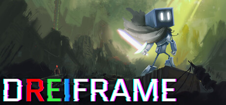
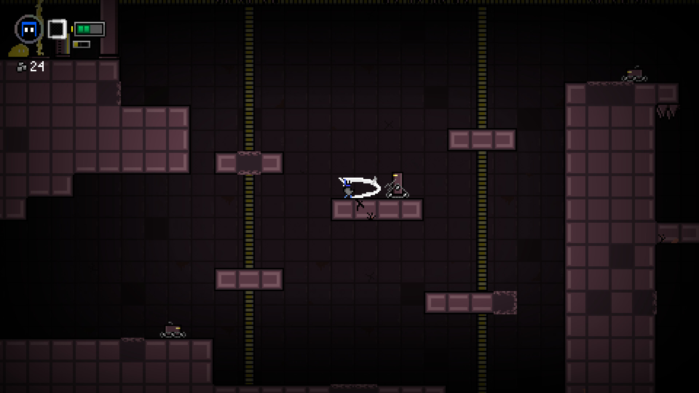
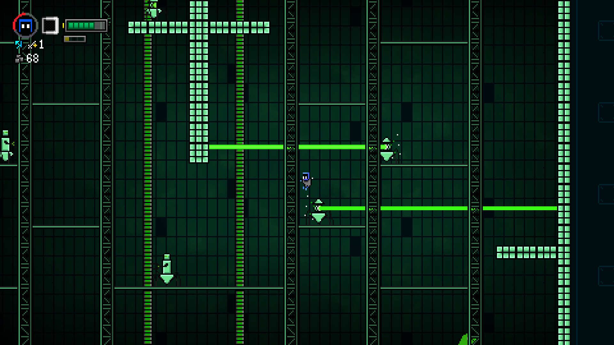
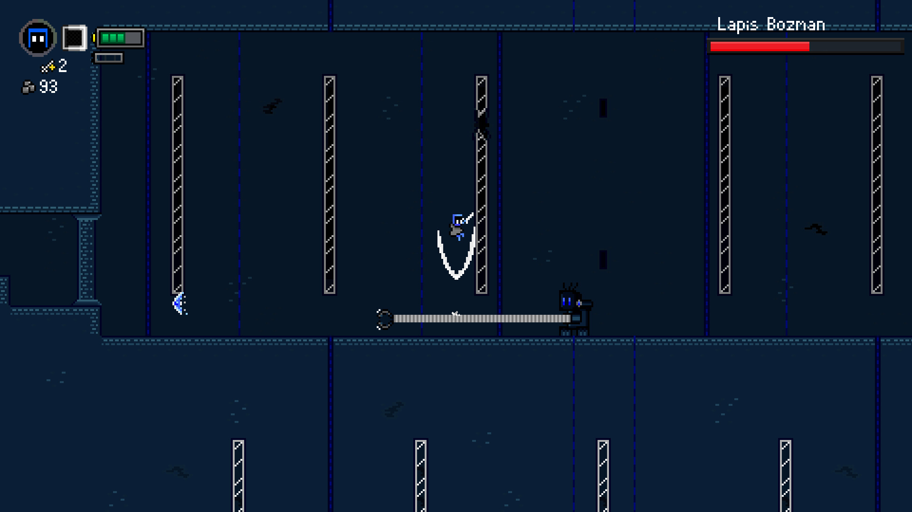

# DREIFRAME - Technical Showcase

<div align="center">

  

  **A solo-developed 2D action platformer (metroidvania), released commercially on Steam.**

  [](https://store.steampowered.com/app/3839190/)

</div>

---

## 📖 About

DreiFrame is a complete commercial game, designed, developed and released entirely by me.

I handled the entire development process independently, from gameplay programming and systems architecture to shipping and maintaining the final product.

The project grew into a large, interconnected codebase:

| Project scale | |
|:---|---:|
| Lines of code | ~100,000 |
| Game objects | ~800 |
| Main locations | 9 |
| Rooms (GameMaker) | 170 |

Beyond gameplay, development involved engineering challenges common to larger software projects: state management, data persistence and versioning, configurable input, localization and third-party platform integration.

---

## 📸 Screenshots

<!-- Replace these placeholders with actual gameplay screenshots -->

<p align="center">
  
  
  
</p>

---

## 🛠️ Technology Stack

| Category | Technology |
|:---|:---|
| Engine | GameMaker |
| Languages | GML, GLSL ES |
| Data formats | JSON |
| Platform integration | Steamworks SDK |
| Platform | Windows (Steam) |

---

## 💻 Technical Highlights

> Code snippets below are simplified excerpts that show the approach. They are not copied from the production code.

### Save System & Data Versioning

Game state is serialized into JSON and written to disk through byte buffers. Values are validated and clamped during loading, corrupted files are handled gracefully, and older save files remain compatible with newer game versions.

```gml
function load_game(_file)
{
    if (!file_exists(_file)) return false;

    var _buffer = buffer_load(_file);
    var _json   = buffer_read(_buffer, buffer_string);
    buffer_delete(_buffer); // free memory right after reading

    var _data;
    try { _data = json_parse(_json); }
    catch (_e) { return false; } // corrupted save: fail safely

    // Older saves: fill in missing data with defaults
    if (!variable_struct_exists(_data, "settings")) _data.settings = default_settings();

    // Never trust data from disk
    global.state.hp = clamp(_data.hp, 1, get_max_hp());
    return true;
}
```

### Input System & Runtime Rebinding

A unified input layer maps keyboard, mouse and gamepad controls to named actions. Players can rebind controls at runtime, conflicting bindings are resolved automatically, and settings persist between sessions.

```gml
global.input_map = { jump: vk_space, attack: ord("X") };

function input_rebind(_action, _key)
{
    // If the key is already used, swap the two bindings
    var _names = variable_struct_get_names(global.input_map);
    for (var i = 0; i < array_length(_names); i++)
        if (global.input_map[$ _names[i]] == _key)
            global.input_map[$ _names[i]] = global.input_map[$ _action];

    global.input_map[$ _action] = _key;
}

// Gameplay code checks actions, never raw keys
if (keyboard_check_pressed(global.input_map.jump)) jump();
```

### Data-Driven World Map

Levels, connections and completion conditions are defined through data. A dedicated rules system determines area completion and calculates overall world progress.

```gml
// Completion rules are data, not code
global.room_rules[? "RoomA"] = { items: [101, 102], events: [12] };

function room_is_completed(_room)
{
    var _rules = global.room_rules[? _room];
    if (is_undefined(_rules)) return false;

    for (var i = 0; i < array_length(_rules.items); i++)
        if (ds_list_find_index(global.collected_items, _rules.items[i]) == -1) return false;

    for (var i = 0; i < array_length(_rules.events); i++)
        if (ds_list_find_index(global.events_played, _rules.events[i]) == -1) return false;

    return true;
}

// When an event finishes: record it, then re-check the room
ds_list_add(global.events_played, _event_id);
if (room_is_completed("RoomA")) map_mark_completed("RoomA");
```

### Steamworks Integration

An achievement queue handles communication with Steamworks. Achievements are processed once the SDK is ready, while already unlocked achievements are skipped to avoid unnecessary calls and blocking gameplay.

```gml
// Gameplay only queues the achievement; duplicates are ignored
function achievement_unlock(_id)
{
    if (ds_list_find_index(global.pending_achievements, _id) == -1)
        ds_list_add(global.pending_achievements, _id);
}

// Step event: send one queued achievement per frame once Steam is ready
if (steam_initialised() && steam_stats_ready() && ds_list_size(global.pending_achievements) > 0)
{
    var _id = global.pending_achievements[| 0];
    if (!steam_get_achievement(_id)) steam_set_achievement(_id); // skip if already unlocked
    ds_list_delete(global.pending_achievements, 0);
}
```

### Object Architecture & Localization

A reusable object hierarchy provides shared functionality for enemies, attacks and interactable objects, with dozens of specialized implementations.

All in-game text and menus support runtime switching between English and Polish.

```gml
enum LANG { ENG, PL }

// Every text request goes through one function that picks the right language
function get_text(_text_id)
{
    switch (global.settings.lang)
    {
        case LANG.PL: return text_pl(_text_id);
        default:      return text_en(_text_id); // English as fallback
    }
}

// Item names and descriptions come from a per-language table
var _loc = global.item_localization[_item_id][global.settings.lang];
item.name = _loc.name;
```

---

## 🛡️ Source Code

The source code is kept private due to the commercial nature of the project.

I'm happy to discuss the architecture, technical decisions and implementation details in more depth.

---

<div align="center">

  **DreiFrame - Independently developed and released on Steam.**

  [Steam Store Page](https://store.steampowered.com/app/3839190/)

</div>